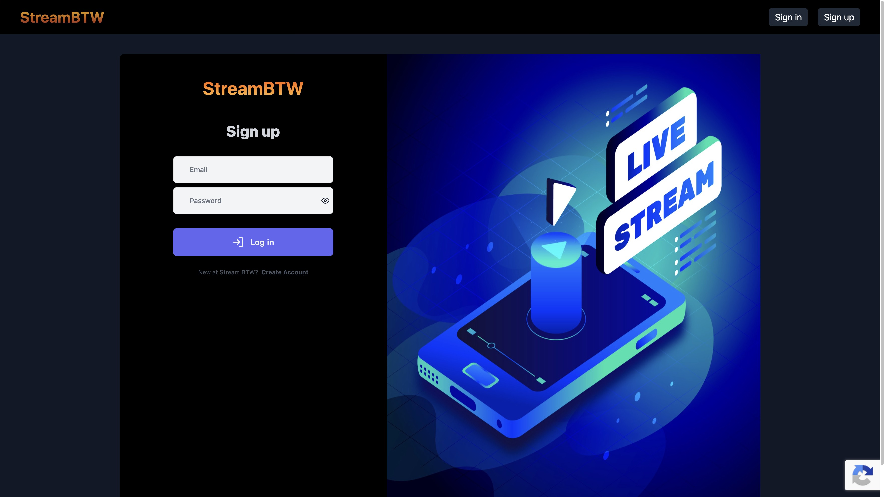
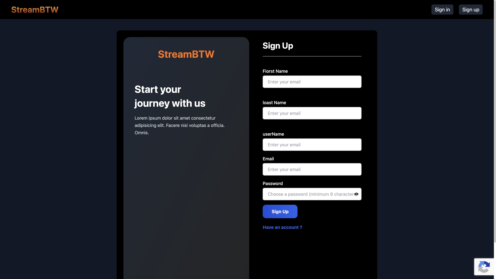
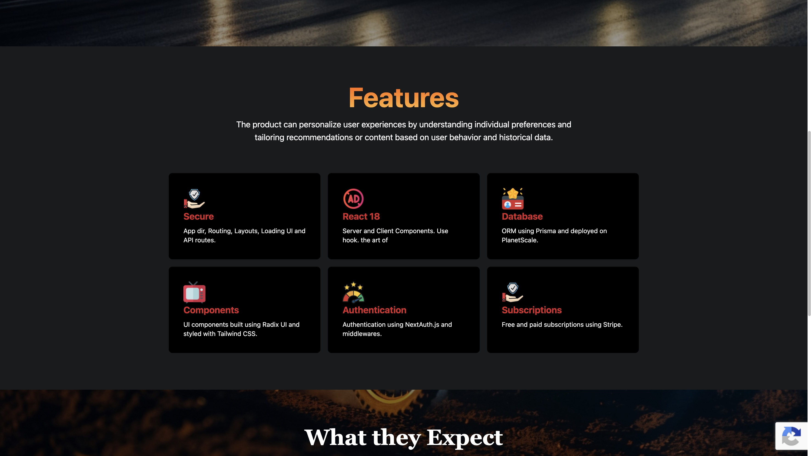
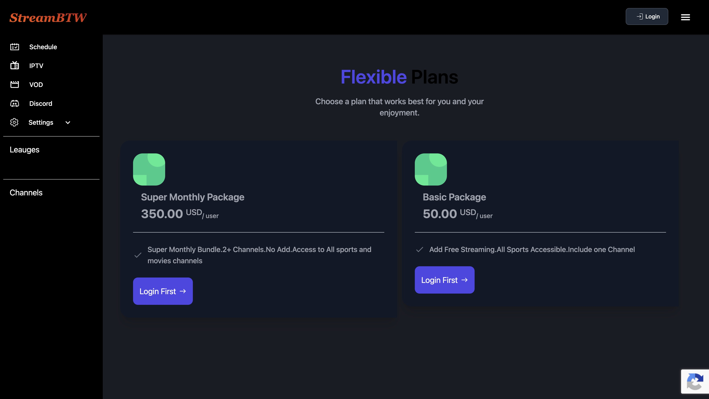
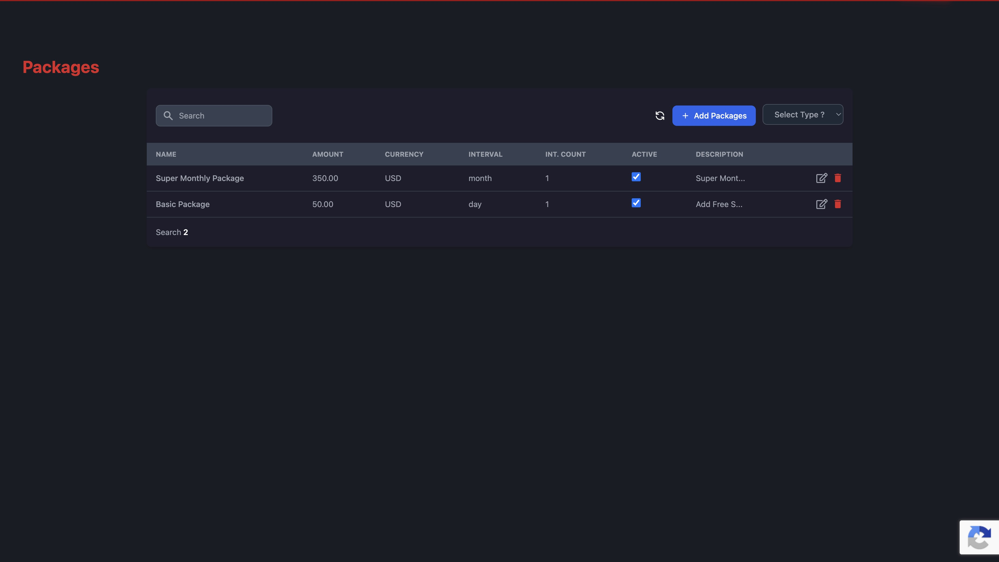
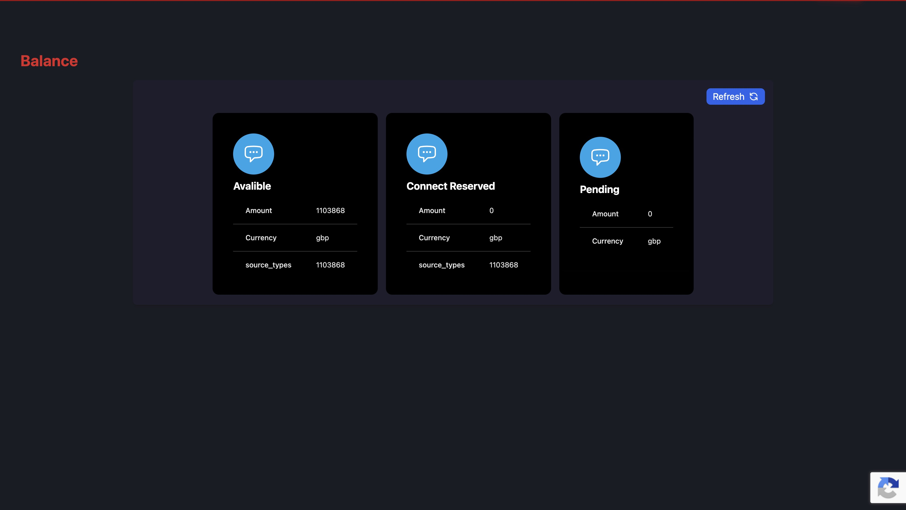
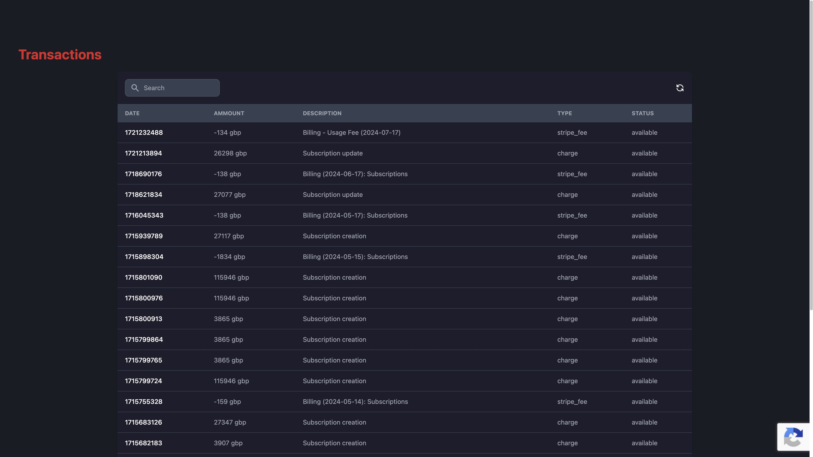

# Streaming Semester Project

A full-stack **live sports / PPV streaming** semester project with **Stripe** memberships, auth, and an admin billing dashboard.

Built with **Next.js 14**, **NextAuth**, **MongoDB**, **Stripe**, and **Tailwind CSS**.

Product UI brand: **StreamBTW**.

## Screenshots

### Home


### Sign in


### Sign up


### Features section


### Stripe — membership plans


### Stripe — packages (admin)


### Stripe — balance (admin)


### Stripe — transactions (admin)


## Features

- Public landing page for live PPV / sports streaming
- Email/password auth via NextAuth (credentials)
- Membership plans and subscription billing with Stripe
- Member schedule and media player views
- Admin dashboard (users, packages, leagues, teams, games, channels, Stripe balance & transactions)

## Tech stack

| Layer | Choice |
| --- | --- |
| Framework | Next.js 14 (Pages Router) |
| UI | React 18, Tailwind CSS |
| Auth | NextAuth.js |
| Database | MongoDB + Mongoose |
| Payments | Stripe |
| Bot protection | Google reCAPTCHA |

## Getting started

### Prerequisites

- Node.js 18+
- A MongoDB database (Atlas or local)
- Stripe account (test keys are fine for local)
- reCAPTCHA keys (optional for some flows)

### Setup

```bash
git clone https://github.com/umeraamir69/streaming-semester-project.git
cd streaming-semester-project
cp .env.example .env
# fill in your own keys in .env — never commit real secrets
npm install
npm run dev
```

Open [http://localhost:3000](http://localhost:3000).

### Environment variables

Copy `.env.example` to `.env` and set your own values. The example file ships **empty** (no real keys).

Required for a working local run:

- `MONGODB_URI`
- `AUTH_SECRET` / `JWT_SECRET_KEY`
- `NEXTAUTH_URL` (`http://localhost:3000` locally)
- `STRIPE_PUBLISHABLE_KEY` / `STRIPE_SECRET_KEY`
- `RECAPTCHA_SITE_KEY` / `RECAPTCHA_SECRET_KEY` (if using captcha)

`.env` is gitignored. Do not commit secrets.

### Scripts

```bash
npm run dev      # development server
npm run build    # production build
npm run start    # run production build
npm run lint     # ESLint
```

## Project layout

```
components/          # UI (home, auth, dashboard)
src/pages/           # Routes + API handlers
  auth/              # Login, create account
  dashboard/         # Admin panels
  api/               # Auth, Stripe, CRUD APIs
public/images/       # Static assets
docs/screenshots/    # README screenshots
```

## Security note

Earlier commits may have contained a real `.env`. All secret values have been removed from the working tree. **Rotate every secret that was ever committed** (Stripe, MongoDB, JWT, NextAuth, reCAPTCHA) before using this in production.

## License

Academic semester project unless otherwise stated.
